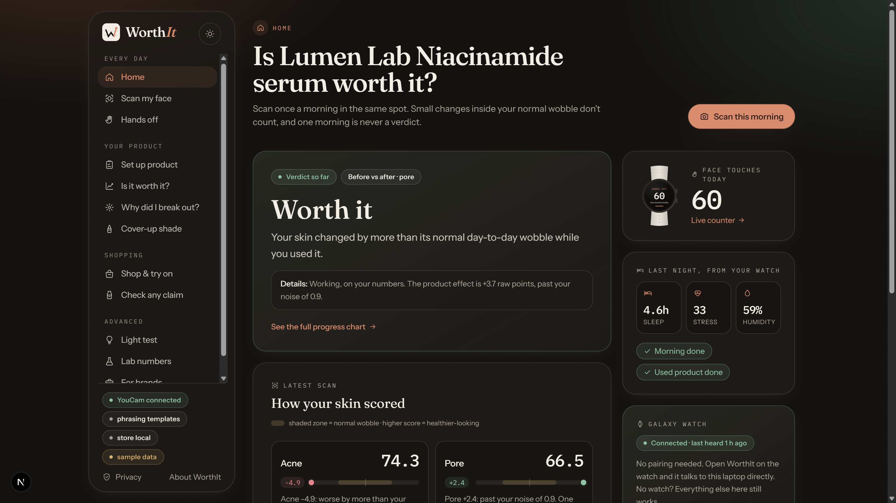
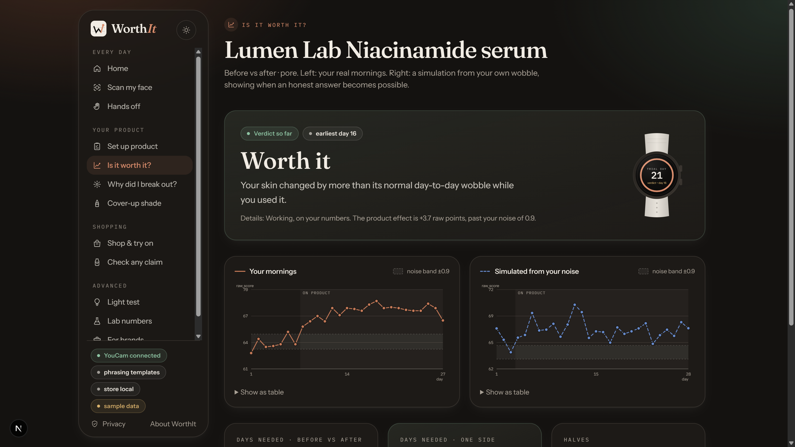
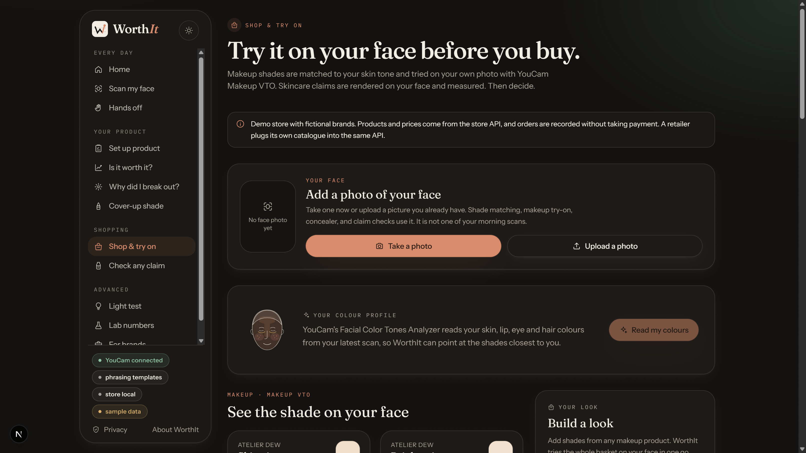
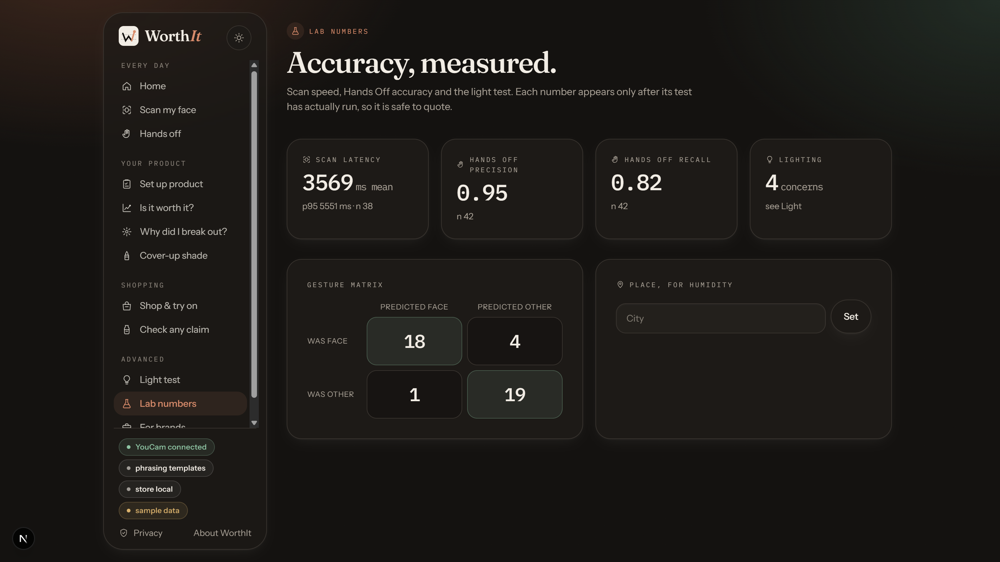
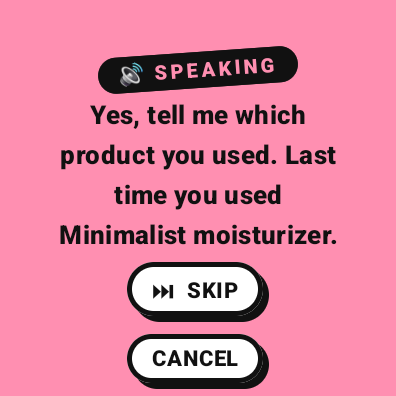
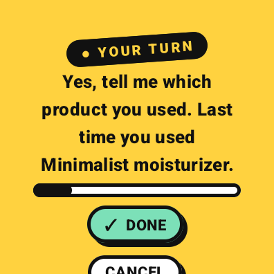
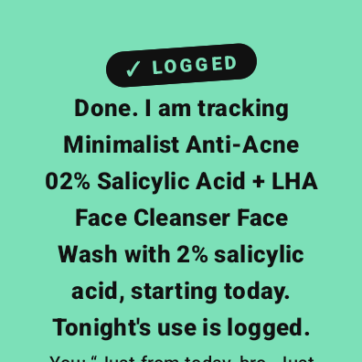
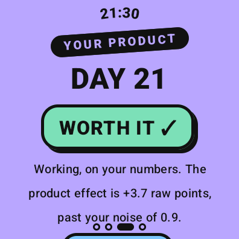
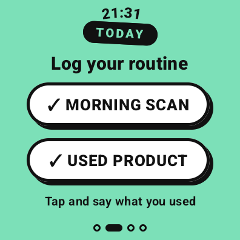
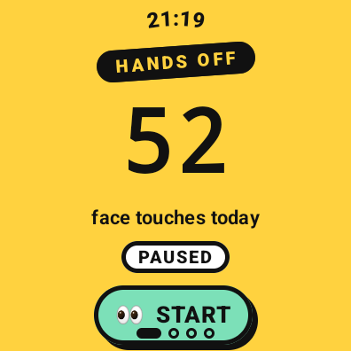

<div align="center">

# WorthIt

### Is your skincare actually working? Your face, your data, a straight answer.

**YouCam Skin AI · YouCam Makeup VTO · Galaxy Watch4 · Sarvam Voice AI · Bayesian statistics**

*Built for the YouCam API Skin AI & eCommerce VTO Hackathon by Perfect Corp.*



</div>

---

## The problem

Every skincare shopper asks the same question, three weeks after checkout: **"Is this actually doing anything?"**

Nobody can answer it today. Mirrors lie, lighting changes every morning, and a bad night's sleep or a stressful week can look exactly like a product failing. So people either keep paying for products that do nothing, or they abandon products that were working. Returns, churn and distrust follow, and brands never learn which products actually perform on real faces.

## The answer

**WorthIt turns the YouCam Skin AI into a personal, scientific product test.** You scan once a morning. Your Galaxy Watch quietly records the things a mirror cannot see: sleep, stress, how often you touch your face. WorthIt separates the product's real effect from that noise and gives you one of four honest verdicts:

| Verdict | Meaning |
| --- | --- |
| **Worth it ✓** | Your skin changed by more than its normal day-to-day wobble while you used it |
| **Not worth it** | The change sits inside your own noise |
| **Making it worse** | The score moved the wrong way on the days you used it |
| **Too early** | Not enough mornings yet, and WorthIt tells you the exact day an honest answer becomes possible |

Then it closes the loop with commerce: it matches shades to your measured skin tone, lets you try makeup on your own face, checks marketing claims against your own skin before you buy, and sells through a working bag and checkout.

---

## Why it stands out

- **Not a wrapper. A measurement system.** Every YouCam score goes into a statistical model with a measured noise floor (MDC95), a Bayesian effect estimate, and a Monte Carlo "earliest honest day".
- **Three devices, one ledger.** A Next.js web app, a Wear OS app on a Galaxy Watch4, and an Android phone app, all live-synced over server-sent events. No pairing codes.
- **Voice AI on the wrist.** Tap *Used product* on the watch and just talk. Sarvam speech-to-text and text-to-speech run a short conversation, and the laptop updates live.
- **Six YouCam capabilities working together:** Skin Analysis, Skin Simulation, Facial Color Tones Analyzer, Makeup VTO, Camera Kit, and the File API.
- **Commerce with a conscience.** The shop says *SKIP* when a product's claim would not show up on your skin. That builds trust that converts.

---

## Screenshots

> The app below is running with the built-in sample-data mode (`npm run demo:seed`) so every chart is populated. A "sample data" pill marks it in the UI.

### Is it worth it? The progress chart
Your real mornings on the left. On the right, a simulation built from your own noise shows when an honest answer becomes possible.



### Shop & try on: YouCam Makeup VTO plus the colour profile
Shades ranked by CIELAB distance to your measured skin and lip colour, tried on your own photo, then added to the bag.



### Lab: accuracy, measured
Scan latency, Hands Off precision and recall, and the gesture confusion matrix. Each number appears only after its test has actually run.



### Galaxy Watch4: voice product log, verdict on the wrist, Hands Off

| Voice: the watch asks | Voice: your turn | Voice: logged |
| :---: | :---: | :---: |
|  |  |  |

| Verdict on the wrist | Daily routine | Hands Off face-touch counter |
| :---: | :---: | :---: |
|  |  |  |

---

## Features

### 1. Skin AI: the measurement engine
- **YouCam AI Skin Analysis** scores acne, pores, redness and texture on every morning scan (SD by default, HD per scan).
- **Camera Kit gated capture** (`skincare` / `hdskincare`, strict quality) on the phone, so lighting and pose stay consistent.
- **Personal noise floor.** Five back-to-back scans measure the instrument plus your face's normal wobble: `MDC95 = 1.96 · √2 · SEM`. Any change smaller than that is never called a result.
- **Bayesian verdict.** `y = intercept + β · (on × adherence) + covariates + noise`, with a Normal-Inverse-Gamma posterior. *Worth it* requires `P(β > MDC95) ≥ 0.95`.
- **Covariates from the watch and phone:** sleep debt, stress (RMSSD z-score), face-touch count, humidity, menstrual cycle.
- **Earliest honest day.** A seeded Monte Carlo of your own noise finds the first day an answer is 80% likely to be reliable.
- **Lighting test.** Ungated vs Camera Kit capture across three lights, which shows why gated capture matters.
- **Why did I break out?** When the acne score drops, WorthIt ranks what else changed (sleep, stress, touches, humidity, product) and never diagnoses.

### 2. eCommerce VTO: shop on your own face
- **YouCam AI Facial Color Tones Analyzer** reads skin, lip, eye, brow and hair colour from your latest scan.
- **Shade matching** by CIELAB distance for foundation, concealer and lip tint.
- **YouCam AI Makeup VTO** applies foundation, concealer, lip colour or blush to your photo. Try one shade, or the whole basket in a single call, with a before/after slider.
- **Claim check before you buy.** **YouCam AI Skin Simulation** renders the marketing claim on your face, then **Skin Analysis** measures the render. If the change is inside your noise: *SKIP*. If larger: *TEST IT*. A safety filter blocks medical words (cure, treat, diagnose, guaranteed…).
- **Bought it? Test it.** One tap turns a purchase into a product test with the product pre-filled.
- **Breakout-day cover-up.** A concealer shade matched and tried on for the morning your skin needs it.
- **Full store API:** catalogue with brands, shades and SKUs in INR, a per-account bag, shipping rules, checkout and order history.

### 3. Galaxy Watch4: the sensor nobody else uses
- **Hands Off:** accelerometer and gyroscope with a 5-touch calibration and a nearest-centroid classifier. It detects hand-to-face touches (a major breakout trigger), buzzes, and counts live on the laptop.
- **Voice product log (Sarvam AI):** *"Which product did you use?"* → *"Minimalist anti acne face wash"* → *"What's the main ingredient?"* → *"2 percent salicylic acid, starting today"*. The watch records, Sarvam Saarika transcribes, Sarvam Bulbul speaks back, and the product test is created automatically. It is multilingual-ready: Hindi, Tamil, Telugu and more are one setting away.
- **Verdict tile** and verdict page on the wrist, plus a morning wake buzz to scan at the same time daily.
- **Gesture lab:** labelled accuracy tests feed precision, recall and the confusion matrix.

### 4. Phone sync (Android)
- Reads last night's sleep and cycle from **Health Connect** (Samsung Health writes there) and posts it to the ledger.
- A WebView shell of the full app, with an instant connection to the laptop on the same Wi-Fi.

### 5. For brands and retail
- **Retail page:** days-to-detect and false-*Worth it* rate, simulated from real users' noise, so a brand can design an honest in-store or online test.
- An anonymised, consented signal of which products actually move skin, the data beauty brands have never had.

### 6. Privacy by design
- Explicit consent before any scan. Local JSON ledger with optional Supabase replication and **remote delete**.
- Sample data is clearly labelled and removable in one click.

---

## YouCam APIs used

| YouCam API | Task | Where WorthIt uses it |
| --- | --- | --- |
| **AI Skin Analysis** | `skin-analysis` | Every morning scan, noise floor, breakout attribution, and measuring Skin Simulation renders |
| **AI Skin Simulation** | `skin-simulation` | Claim check: render the promise on your face, then measure it |
| **AI Facial Color Tones Analyzer** | `skin-tone-analysis` | Colour profile, foundation / concealer / lip shade matching |
| **AI Makeup VTO** | `makeup-vto` (foundation, concealer, lip_color, blush) | Shop try-on, whole-look try-on, breakout-day concealer |
| **JS Camera Kit** | `skincare` / `hdskincare` | Quality-gated capture on the phone |
| **File API** | `POST /s2s/v2.0/file` | Uploads for every task |

Results are cached by image bytes and request, so re-running the same photo never spends units twice.

**Other AI in the pipeline:** Sarvam AI (Saarika STT, Bulbul v3 TTS) for the voice log, Anthropic Claude (optional) for phrasing and reading pack photos, MediaPipe Face Landmarker for split-face midlines, and Open Beauty Facts for barcode lookups.

---

## Architecture

```
 ┌──────────────── Galaxy Watch4 (Wear OS, Kotlin + Compose) ────────────────┐
 │  Hands Off classifier · Voice log (mic + speaker) · Verdict tile · Wake   │
 └──────────────┬───────────────────────────────────────────▲────────────────┘
                │ events, audio (Wi-Fi)                     │ verdict, speech
 ┌──────────────▼───────────────── Next.js 15 "desk" (laptop) ───────────────┐
 │  Scan ───────► YouCam Skin Analysis ─┐                                    │
 │  Claim check ► YouCam Skin Simulation ├─► Bayesian model ─► Verdict       │
 │  Colour ─────► YouCam Color Tones ────┤   noise floor, Monte Carlo        │
 │  Try-on ─────► YouCam Makeup VTO ─────┘                                   │
 │  /api/voice ─► Sarvam STT/TTS        /api/shop ─► bag, checkout, orders   │
 │  JSON ledger (+ Supabase replica) ── server-sent events to every screen   │
 └──────────────▲───────────────────────────────────────────────────────────-┘
                │ sleep, cycle (Health Connect)
 ┌──────────────┴──────── Android phone (WebView + Health Connect) ─────────┐
 └──────────────────────────────────────────────────────────────────────────┘
```

| Path | What |
| --- | --- |
| `apps/web` | Next.js 15 web app and API ("the desk") |
| `apps/watch` | Wear OS app for Galaxy Watch4 |
| `apps/phone-sync` | Android phone app, Health Connect sync |
| `supabase/schema.sql` | Optional remote replica |
| `docs/api.md` | API contract |

---

## Run it

```bash
cd apps/web
cp ../../.env.example .env.local   # add YOUCAM_API_KEY, optional SARVAM_API_KEY / ANTHROPIC_API_KEY
npm install
npm test                           # 36 tests: stats engine, verdicts, sample data, voice parsing
npm run dev -- -H 0.0.0.0 -p 3000
```

Open http://localhost:3000/today and accept the consent screen.

- **Fill every chart instantly:** `npm run demo:seed` (remove with `npm run demo:clear`, or from Privacy).
- **Watch:** set `worthitServer=http://<laptop-ip>:3000` in `apps/watch/gradle.properties`, then `./gradlew :app:installDebug`.
- **Phone:** `./gradlew -p ../phone-sync :app:assembleDebug` from `apps/watch`, then install the APK.

| Environment variable | Purpose |
| --- | --- |
| `YOUCAM_API_KEY` | All YouCam calls (required) |
| `YOUCAM_MODE` | `sd` (default) or `hd` skin analysis |
| `SARVAM_API_KEY` | Voice product log on the watch |
| `ANTHROPIC_API_KEY` | Optional phrasing and pack-photo reading |
| `SUPABASE_URL` / `SUPABASE_SERVICE_ROLE_KEY` | Optional remote ledger |

---

## Roadmap

These are planned next and are **not in this build**:

- **Agentic routine coach:** an agent that reads your verdicts and proposes the next product to test, then books the test.
- **Multilingual voice by default:** Hindi, Tamil, Telugu, Bengali and Marathi through the same Sarvam pipeline.
- **Apparel + makeup "full look" try-on:** YouCam clothing VTO combined with makeup VTO in one checkout.
- **Brand dashboard:** consented, aggregated "does it actually work" scores per product, for retailers and brands.
- **Retailer plug-in:** drop-in Shopify / headless-commerce widget using the same store API.
- **iOS and Apple Watch** companions, and HRV from Samsung's Health Sensor SDK.

---

## Responsible by design

WorthIt is a personal test, not medical care, and never calls itself a clinical trial. It never diagnoses. Medical claims are blocked, and every number is shown with its uncertainty.

<div align="center">

**WorthIt: stop guessing. Know if it's worth it.**

</div>
